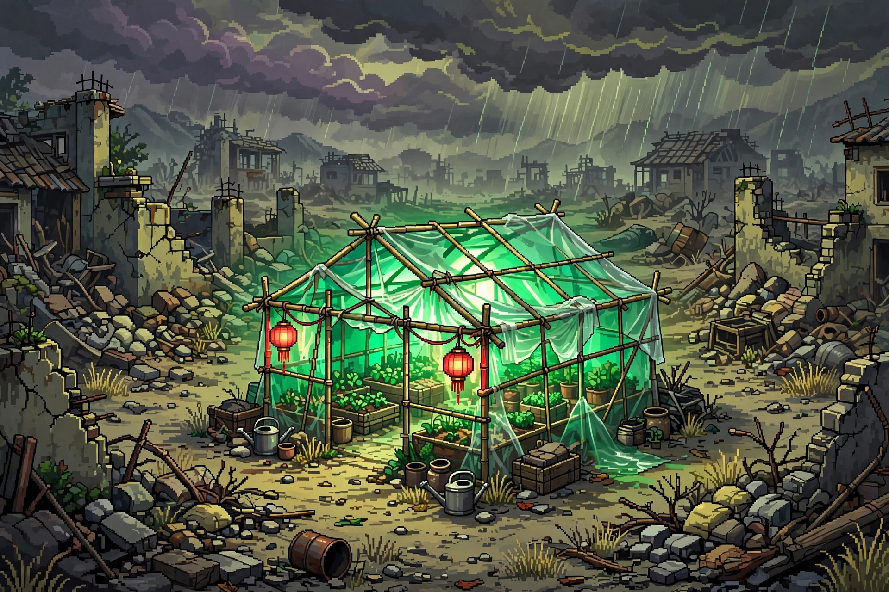
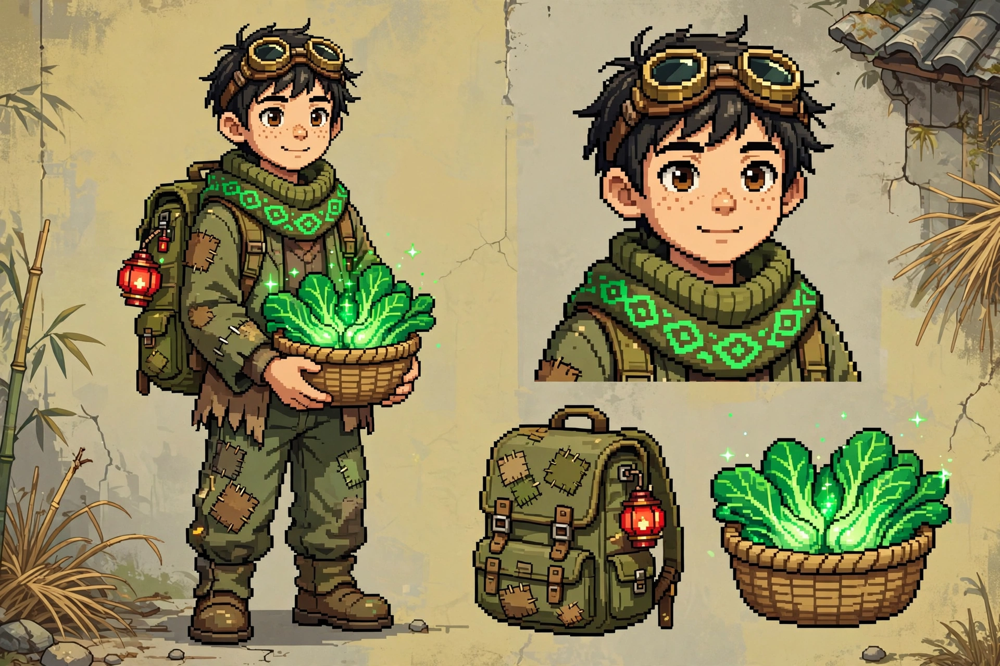

# 废土温室 Wasteland Greenhouse

> 末日种田守绿洲：白天把废土变绿，晚上守住你的绿。

一款 Godot 像素风独立游戏：种田 × 塔防 × 养成三合一。

## 核心玩法

- **白天 — 绿化种田**：用"原始改造新手包"开拓荒地，把灰黄废土变回绿色；种植作物赚钱，买设备、扩土地、建功能区
- **夜晚 — 守家御敌**：载具劫掠者、丧尸潮、变异怪轮番夜袭；围墙 / 哨塔 / 拒马 / 灯笼火盆 + 觉醒者小队守住你的绿
- **集市**：卖货买设备的支撑系统

## 三大系统

1. **绿化种植**：看得见的进度（灰→绿）+ 经济循环
2. **防御守家**：波次夜袭，工事相克（拒马专克载具）
3. **招募养成**：废土救人 / 收留叙事（无卡池界面，保 pity）；觉醒者三维（战 / 生 / 建）+ 战斗 / 生长双系异能；主角攒战利品兑换觉醒

## 世界观

灰烬纪 47 年，最后一座生态温室"青禾站"。拾荒者陈默在流浪中发现它，选择留下，把废土种成绿洲。
控制着净水与种子的旧城商会，视这片绿为眼中钉……

## 美术风格

B+D 融合：高饱和翠绿 × 低饱和灰黄废土的强对比（"在绝望里种希望"），叠加中式乡土废土细节（竹木大棚、红灯笼、集市）。

## 路线图

- M1：风格锁定 + 三系统框架（进行中）
- M2–M3：垂直切片（种植 / 防御 / 招募可玩）
- M4：itch.io 验证定生死，问卷"好玩" <60% 就砍
- M5–M8：量产；M9：Steam demo，定价 68–88 元

## 当前状态

设计阶段，代码未开始。完整设计文档（立项一页纸 / 系统设计 / 世界观细纲 / 美术指南）随开发推进同步。

## License

待定
